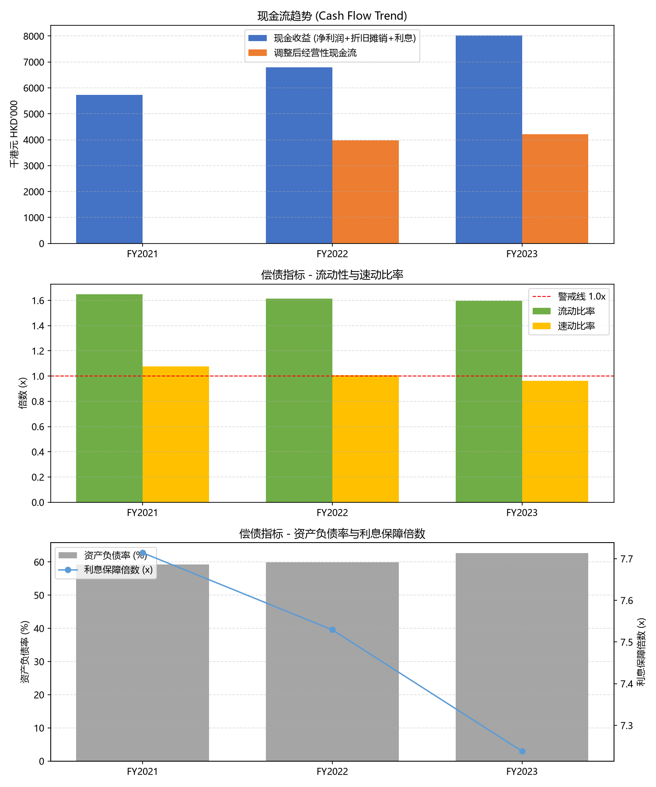

# 中小企业信贷初筛报告 (SME Credit Screening Report)

- 数据来源: `sample_sme_fin.xlsx`
- 数据期间: FY2021, FY2022, FY2023
- 报告基准期间: **FY2023** (最新一期)
- 生成时间: 2026-10-23 19:54:02

## 1. 核心财务指标与银行评级

| 指标 | 计算公式 | 数值 | 银行评级 |
|------|----------|------|----------|
| 流动比率 | 流动资产 / 流动负债 | 1.59x | 关注 |
| 速动比率 | (流动资产 - 存货) / 流动负债 | 0.96x | 关注 |
| 资产负债率 | 总负债 / 总资产 | 62.64% | 关注 |
| 利息保障倍数 | EBIT / 利息费用 | 7.24x | 关注 |
| 简易现金收益 | 净利润 + 折旧摊销 + 利息费用 | 8019 千港元 | - |
| 经营性现金流(调整) | 简易现金收益 - Δ应收 - Δ存货 + Δ应付 | 4219 千港元 | 安全 |

**综合评级: 关注**

## 2. 评级阈值说明 (汇丰香港 CB SME 风控标准)

| 指标 | 安全 | 关注 | 预警 |
|------|------|------|------|
| 流动比率 | >= 1.8x | 1.2x ~ 1.8x | < 1.2x |
| 速动比率 | >= 1.1x | 0.7x ~ 1.1x | < 0.7x |
| 资产负债率 | <= 55% | 55% ~ 70% | > 70% |
| 利息保障倍数 | >= 8x | 3x ~ 8x | < 3x |

## 3. 各期趋势

| 指标 | FY2021 | FY2022 | FY2023 |
|------|------|------|------|
| 流动比率 | 1.65x | 1.61x | 1.59x |
| 速动比率 | 1.08x | 1.01x | 0.96x |
| 资产负债率 | 59.30% | 59.87% | 62.64% |
| 利息保障倍数 | 7.71x | 7.53x | 7.24x |
| 现金收益(简易) | 5724 | 6784 | 8019 |
| 经营性现金流(调整) | N/A | 3984 | 4219 |

## 4. 风险提示与综合结论

### 关注点 (Watch)

- **流动比率** 处于关注区间, 建议结合行业均值与同业对标进一步评估。
- **速动比率** 处于关注区间, 建议结合行业均值与同业对标进一步评估。
- **资产负债率** 处于关注区间, 建议结合行业均值与同业对标进一步评估。
- **利息保障倍数** 处于关注区间, 建议结合行业均值与同业对标进一步评估。

### 正面因素 (Comfort)

- **经营性现金流** 为正, 具备一定经营造血能力。

### 银行视角建议

- 结合客户行业地位、订单储备与抵押/担保情况综合评估授信额度。
- 对处于关注/预警区间的指标, 可要求补充银行流水、应收账龄与存货周转明细。
- 持续监控现金流趋势与杠杆变化, 作为贷后管理早期预警信号。

## 5. 附图

